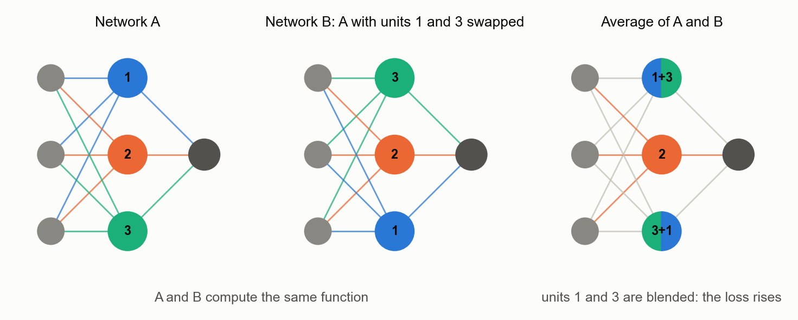
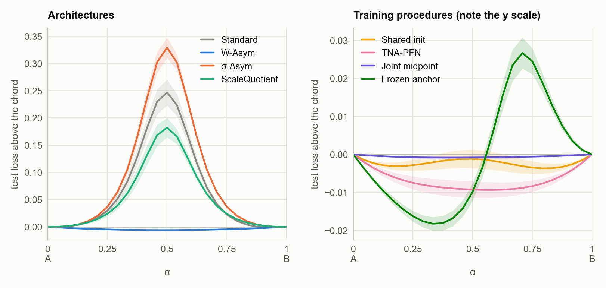
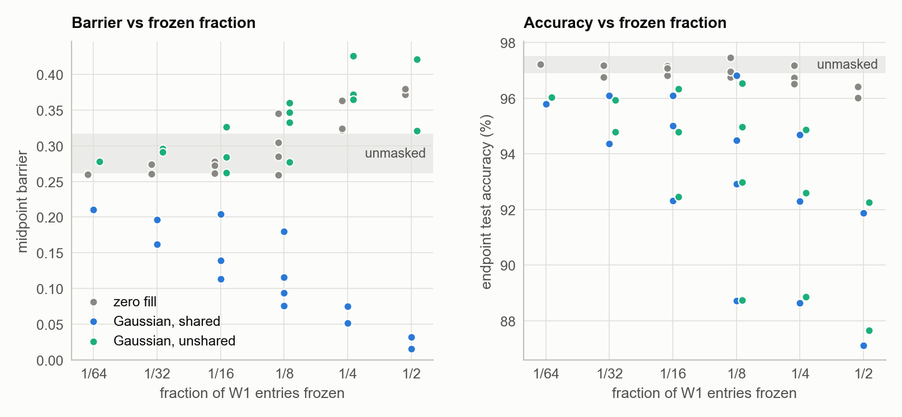

# Parameter symmetry and linear mode connectivity in small MLPs

Two empirical studies of when two independently trained neural networks can be averaged into one that still works. Each tests a way of making the networks' weights line up, so that the loss stays low along the straight line between them.

Neither study produced a publishable result. The repository is a record of what was tested, with the code, raw results, controls and statistics needed to check every number.

Throughout, the barrier between networks A and B is the test cross-entropy of the network with weights ½(θ_A + θ_B), minus the mean test cross-entropy of A and B. A barrier at or below zero means the two can be averaged.

<picture>
  <source media="(prefers-color-scheme: dark)" srcset="figures/diagram_permutation_dark.png">
  
</picture>

## Findings

### 1. MNIST: seven ways to get networks that can be averaged

Full report: [MNIST study report](docs/mnist_study.md), with the methods, every results table, the statistics and the limitations.

MLPs with two hidden layers of width 256, 8 seed pairs per method. Each method is compared with Standard (two independently trained networks):

- architectures: W-Asym and σ-Asym (Lim et al., 2024), which break permutation symmetry, and ScaleQuotient, meant to remove a rescaling symmetry;
- a shared starting point: shared initialisation, and TNA-PFN (Li et al., 2024);
- training the midpoint directly: joint midpoint training and frozen anchor.

<picture>
  <source media="(prefers-color-scheme: dark)" srcset="figures/mnist_paths_dark.png">
  
</picture>

- Permutation symmetry accounts for the whole barrier between independently trained networks: aligning B's hidden units to A's takes it from 0.247 to −0.006.
- W-Asym removes the barrier without alignment, as Lim et al. report; its endpoints are 0.3 points less accurate than Standard's. σ-Asym raises the barrier (0.329), unlike in Lim et al., whose network is larger and trained for longer (the gate is drawn as in their code). ScaleQuotient does not change the barrier detectably and is ordinary weight normalisation.
- Starting both networks from the same initialisation already removes the barrier on MNIST. TNA-PFN's further reduction (−0.008) is not significant after correction.
- Joint midpoint training and frozen anchor include the midpoint's loss in training, so a low midpoint barrier is expected rather than found. Joint midpoint training makes the two networks nearly the same function; frozen anchor gives the most accurate midpoint (98.0%, not significantly above joint midpoint training's 97.8%) but a small barrier elsewhere on the path.

### 2. Does the fill value matter in a W-Asymmetric layer?

Full report: [Fill study report](docs/fill_study.md), with the setup, all 26 fills, every results table, the statistics and the limitations.

W-Asym freezes part of each weight row at fixed values, the fill. This study compared 26 fills on a network with 4 inputs and 11 of them across input sizes, numbers of frozen entries and hidden widths, in one-hidden-layer networks on synthetic data.

<picture>
  <source media="(prefers-color-scheme: dark)" srcset="figures/fills_controls_dark.png">
  
</picture>

- Breaking the symmetry does not by itself lower the barrier. A mask with zero fill, or with a fill drawn separately for each network, is no better than no mask.
- The barrier falls only when both networks share the same non-zero frozen values. The more of the layer is frozen, the lower the barrier and the lower the accuracy.
- The specific fill matters little. No structured fill (orthogonal, ±1, sinusoidal, polynomial) differs detectably from a Gaussian fill in more than 1 of the 15 grid cells at hidden width 32, and averaged over cells no non-zero fill moves the barrier by more than 0.02. The cleanest comparison rescales the same Gaussian draw so that every row holds the same frozen energy (squared norm of the frozen entries): on the larger networks this lowers the barrier slightly on average over cells, in all six width × design combinations tested, by 4–6% at hidden width 32.

## Repository layout

```
lmc/                 library code
  mnist/             data, models, training procedures, metrics, one-pair experiment
  fills/             synthetic tasks, the 26 fills, the masked MLP and pair experiment
  stats.py           paired t-tests, Benjamini–Hochberg q-values
  report.py          reading results, writing the summary tables
  plotting.py        shared figure style (light and dark versions)
scripts/
  run_mnist.py       train MNIST pairs        -> results/mnist/*.jsonl
  run_fills.py       train fill-study pairs   -> results/fills/*.jsonl
  analyze_mnist.py   tables and figures       -> results/mnist/summary_main.md, figures/mnist_*
  analyze_fills.py   tables and figures       -> results/fills/summary.md, figures/fills_*
  make_diagrams.py   explanatory diagrams     -> figures/diagram_*
results/             raw results, one JSON line per trained pair; fields described in results/README.md
figures/             every figure, as <name>.png and <name>_dark.png
docs/                one report per study
```

## Reproducing

Requires Python ≥ 3.9 with PyTorch, torchvision, NumPy, SciPy (≥ 1.11) and Matplotlib. The results were produced with Python 3.9, torch 2.8.0, torchvision 0.23.0, NumPy 2.0.2, SciPy 1.13.1 and Matplotlib 3.9.4, on CPU.

```bash
pip install -e .

# fill study (single-threaded; the commands are independent and can run in parallel)
python scripts/run_fills.py enumeration    #  5 min
python scripts/run_fills.py sweep          #  1 min
python scripts/run_fills.py hybrid         # 30 s
python scripts/run_fills.py width          # 20 s
python scripts/run_fills.py grid           #  7 min
python scripts/run_fills.py grid_wide      #  7 min
python scripts/run_fills.py controls       # 20 s

# MNIST study (downloads MNIST to ./data on first use)
python scripts/run_mnist.py methods        # 25 min
python scripts/run_mnist.py lambda         # 25 min
python scripts/run_mnist.py clique         # 25 min

# tables and figures
python scripts/analyze_fills.py
python scripts/analyze_mnist.py
python scripts/make_diagrams.py
```

Times are for runs on CPU. Each run script appends to its results file and skips pairs already there, so it can be interrupted and restarted. On CPU the runs are deterministic: rerunning a script into an empty directory reproduces the stored records exactly on the machine that produced them, apart from the training times. Other library versions or hardware may change the last digits.

`python scripts/run_mnist.py methods --protocol smoke` followed by `python scripts/analyze_mnist.py --protocol smoke` checks the MNIST pipeline in about two minutes. The `lim_full` protocol (three hidden layers of width 512, 25 epochs) is defined but was not run.

## License and citation

Code and documents are released under the [MIT License](LICENSE). Citation metadata is in [`CITATION.cff`](CITATION.cff).
