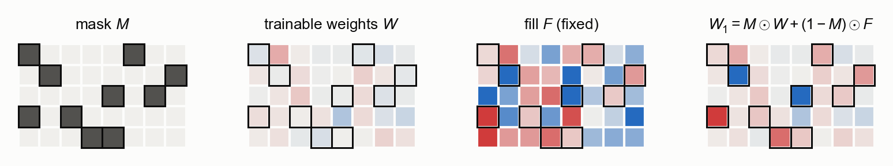
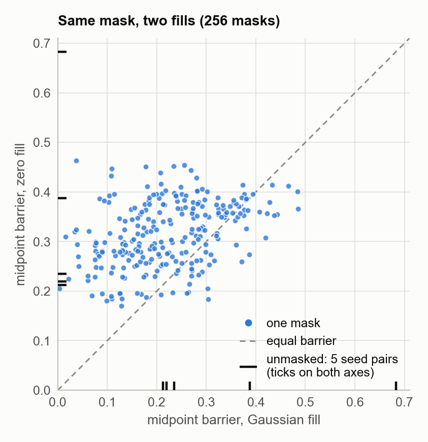
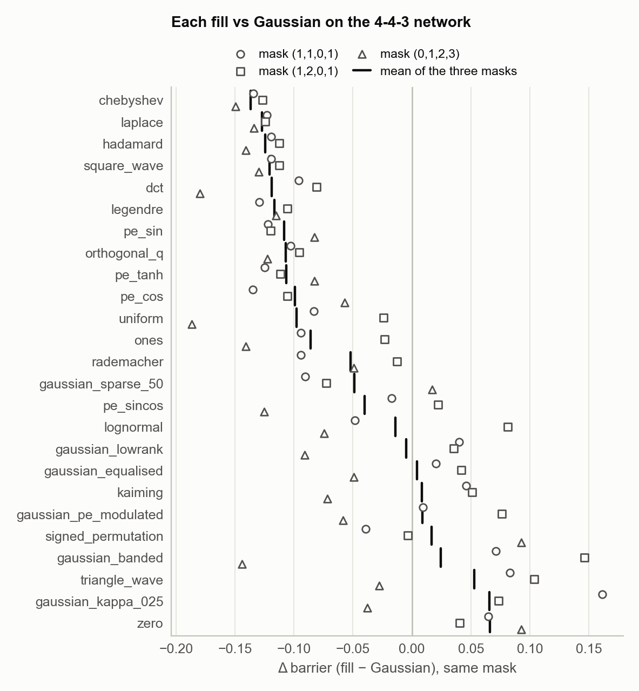
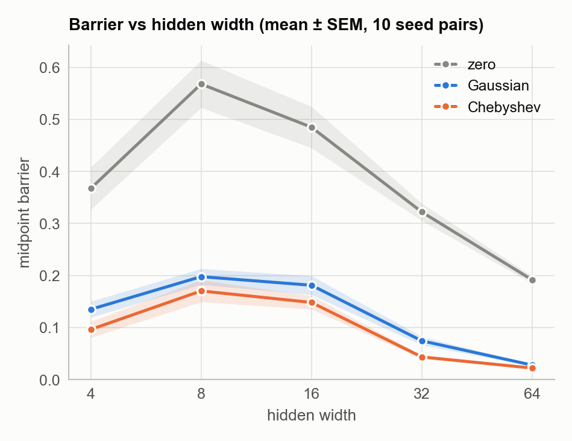
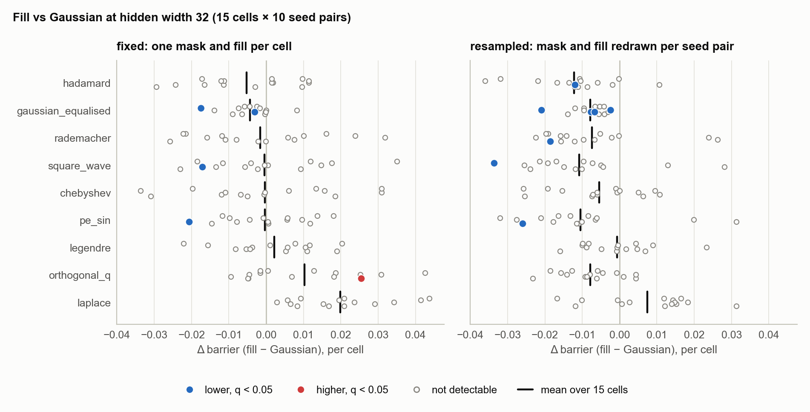
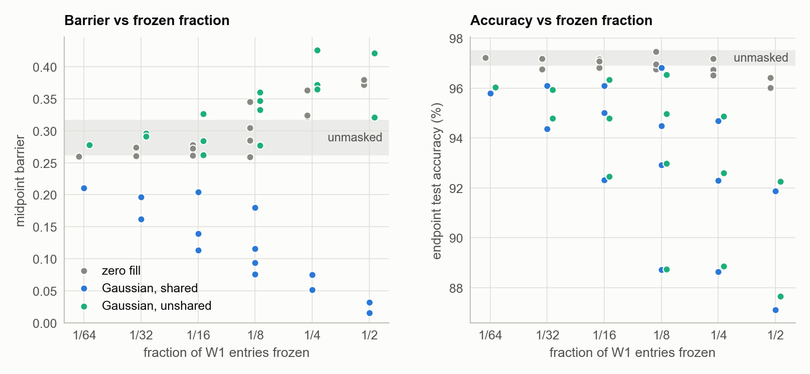

# Does the fill value matter in a W-Asymmetric layer?

W-Asymmetric (W-Asym) networks (Lim et al., 2024) freeze a different subset of each weight row at fixed values, so that hidden units can no longer be permuted without changing the function. Two such networks trained from different initialisations are expected to be linearly connected: the loss stays low along the straight line between them.

This study asks how much that depends on the values held at the frozen entries (the fill), as opposed to which entries are frozen (the mask). It uses one-hidden-layer networks on synthetic data.

Breaking the permutation symmetry does not by itself lower the barrier. A mask with zero fill breaks the symmetry and is no better than no mask, and neither is a non-zero fill drawn independently for each network. The barrier falls only when both networks hold the same non-zero frozen values; the more of the layer is frozen, the lower both the barrier and the endpoint accuracy. Among non-zero fills the differences are small: averaged over cells, no fill moves the barrier by more than 0.02 (17% of the Gaussian fill's). The cleanest comparison rescales a Gaussian fill so that every row holds the same frozen energy, and on the larger networks this lowers the barrier slightly, averaged over cells, in all six width × design combinations tested.

Every number comes from [`results/fills/summary.md`](../results/fills/summary.md), which `scripts/analyze_fills.py` regenerates from the raw results; its sections are named after the experiments below.

## Setup

<picture>
  <source media="(prefers-color-scheme: dark)" srcset="../figures/diagram_masked_layer_dark.png">
  
</picture>

### Network

One hidden layer, `x → W2 · relu(W1 · x)`, with no biases and no normalisation. Only W1 is masked:

    W1 = M ⊙ W + (1 − M) ⊙ F

M has `n_frozen` zeros in each row (outlined in the diagram; in W, F and W1, blue is negative and red positive), at positions drawn independently for each row. F is the fill. M and F are fixed before training and shared by the two networks of a pair, which differ only in their random initialisation. A zero fill is plain structured sparsity.

### Barrier

For two trained networks θ_A and θ_B, the midpoint barrier is

    L(½(θ_A + θ_B)) − ½(L(θ_A) + L(θ_B)),

with L the cross-entropy on held-out test data. Zero means the midpoint is as good as the endpoints on average.

### Tasks and training

| | 4-4-3 network | larger networks |
|---|---|---|
| architecture | 4 → 4 → 3 | in_dim → hidden → 10 |
| data | 3-class Gaussian mixture in ℝ⁴, 600 train / 300 test | 10-class Gaussian mixture in ℝ^in_dim, 2,000 train / 1,000 test |
| frozen entries | 1 per row | `n_frozen` ∈ {4, 8, 16, 32} per row |
| training | 200 full-batch AdamW steps, lr 5·10⁻³, no weight decay | 100 full-batch AdamW steps, lr 5·10⁻³, no weight decay |
| replicates | 5 seed pairs | 10 seed pairs |

A cell is one (in_dim, `n_frozen`) combination. A mask on the 4-4-3 network is written as the list of inputs its rows freeze: mask (1,1,0,1) freezes input 1 in rows 0, 1 and 3 and input 0 in row 2.

### Fills

26 fills are defined in [`lmc/fills/catalog.py`](../lmc/fills/catalog.py). All 26 are run on the 4-4-3 network; the larger networks use 11 of them. Gaussian, ±1 and Laplace fills have unit variance per entry; most structured fills are rescaled so that each row has the root-mean-square norm of an N(0, 1) row (√in_dim), so they differ from the Gaussian fill in structure, not in energy.

The 26 fills

| family | fill | definition |
|---|---|---|
| constant | `zero`, `ones` | all 0; all 1 |
| i.i.d. light-tailed | `gaussian` | N(0, 1) |
| | `gaussian_kappa_025` | N(0, 0.25²) |
| | `uniform` | U(−1, 1), rows rescaled |
| | `rademacher` | ±1 with equal probability |
| | `kaiming` | N(0, 2 / in_dim) |
| i.i.d. heavy-tailed | `laplace` | Laplace with unit variance |
| | `lognormal` | exp(N(0, 0.25)), centred, rows rescaled |
| orthogonal basis | `orthogonal_q` | rows of a random orthogonal matrix |
| | `hadamard` | random rows of a Sylvester Hadamard matrix (±1; in_dim a power of 2) |
| | `dct` | random rows of the DCT-II basis |
| | `signed_permutation` | one entry ±√in_dim per row, in distinct columns |
| sinusoidal | `pe_sin`, `pe_cos` | the first `hidden` rows (lowest frequencies) of the DST-IV and DCT-IV bases: sin and cos of π(i + ½)(j + ½) / in_dim |
| | `pe_sincos` | transformer positional encoding, row = position |
| | `pe_tanh` | tanh(2 sin(π(i + ½)(j + ½) / in_dim)), rows rescaled |
| waveform | `triangle_wave` | triangle wave whose frequency rises with the row |
| | `square_wave` | sign of `pe_sin` (±1) |
| polynomial | `chebyshev` | random rows of Chebyshev polynomials at the Chebyshev nodes (the same basis as `dct`) |
| | `legendre` | random rows of Legendre polynomials at evenly spaced points |
| patterned Gaussian | `gaussian_lowrank` | rank 1: every row a multiple of one Gaussian vector |
| | `gaussian_banded` | Gaussian on the band \|i − j\| ≤ 1, zero elsewhere |
| | `gaussian_pe_modulated` | Gaussian times the sine pattern of `pe_sin`, rows rescaled |
| | `gaussian_sparse_50` | Gaussian with each entry zeroed with probability ½ (unit variance kept) |
| | `gaussian_equalised` | on the larger networks, the `gaussian` draw of the same cell and seed pair with each row's frozen entries rescaled to squared norm `n_frozen`, as for ±1 fills; in `sweep`, a separate draw, which with one frozen entry per row leaves only ±1 values |

Basis fills take `hidden` rows of an in_dim × in_dim basis and so need hidden ≤ in_dim. `chebyshev` and `dct` return the same matrix for the same seed; in `sweep` they are seeded differently and so use different rows.

### Designs

The larger networks are run under two designs.

- Fixed: each cell uses one mask draw and one fill draw for all of its seed pairs, so the seed pairs differ only in their initial weights.
- Resampled: each seed pair draws its own mask and fill, so a difference has to hold across draws to show up. Fills with no random draw (`pe_sin`, `square_wave`, `zero`) change only through the mask.

Within a design the cells are not independent. With one seed, the mask for a smaller `n_frozen` freezes a subset of the entries frozen by a larger one, the fill is the same matrix for every `n_frozen` at a given in_dim, and all cells with the same in_dim share data and initial weights.

### Statistics

Each fill is compared with the Gaussian fill in the same cell, paired by seed, with a t-test on the per-pair differences (Δ = fill − Gaussian barrier). Per-cell tests get Benjamini–Hochberg (BH) q-values over all fills and cells of a design. A fill's mean Δ over cells is tested over the 10 seed pairs (each pair's Δ averaged over cells), with BH over fills and designs. "Detectable" means q < 0.05.

## 1. Zero vs Gaussian fill on every mask of the 4-4-3 network

`run_fills.py enumeration`: all 256 masks with one frozen entry per row, each with zero fill and with its own Gaussian draw.

<picture>
  <source media="(prefers-color-scheme: dark)" srcset="../figures/fills_enumeration_dark.png">
  
</picture>

| condition | mean barrier | SD | range |
|---|---:|---:|---:|
| unmasked (5 seed pairs) | 0.348 | 0.201 | 0.213 – 0.683 |
| zero fill (256 masks) | 0.315 | 0.066 | 0.170 – 0.463 |
| Gaussian fill (256 masks) | 0.221 | 0.100 | 0.003 – 0.485 |

With the mask held fixed, the Gaussian fill gives the lower barrier on 211 of 256 masks, by 0.094 on average (Wilcoxon signed-rank p = 1.4 × 10⁻³⁰). The number of distinct inputs the four rows freeze matters little: from 1 to 4 distinct inputs, the Gaussian-fill barrier goes from 0.268 to 0.206, and the zero-fill barrier stays between 0.28 and 0.32. The unmasked network was trained with only 5 seed pairs, whose barriers range from 0.21 to 0.68; in three of them one network failed to train (test accuracy 0.33–0.67, against 0.98–1.00 for its partner), so this experiment cannot say whether either fill beats no mask; section 6 answers that on the larger networks.

## 2. All 26 fills on three masks of the 4-4-3 network

`run_fills.py sweep`: each fill is one draw, used on masks (1,1,0,1), (1,2,0,1) and (0,1,2,3).

<picture>
  <source media="(prefers-color-scheme: dark)" srcset="../figures/fills_sweep_dark.png">
  
</picture>

17 of the 24 fills other than zero and Gaussian have a lower mean barrier than Gaussian, led by `chebyshev` (−0.137), `laplace` and `hadamard`. The ranking reflects the four sampled frozen values, not fill structure. With one frozen entry per row, each network holds exactly four fill values, and fills that happen to place the same four values give identical runs:

- `hadamard` and `square_wave` on masks (1,1,0,1) and (1,2,0,1)
- `ones` and `rademacher` on mask (1,1,0,1)
- `zero` and `signed_permutation`, `ones` and `hadamard`, and `rademacher` and `gaussian_equalised` on mask (0,1,2,3)

Across the 26 fills, the mean magnitude of the four frozen values alone has Spearman ρ = −0.68 with the mean barrier.

`run_fills.py hybrid` sets k of the four frozen entries to Gaussian values and the rest to zero, over every subset of size k:

| mask | k = 0 (zero fill) | k = 1 | k = 2 | k = 3 | k = 4 (Gaussian) |
|---|---:|---:|---:|---:|---:|
| (1,1,0,1) | 0.205 ± 0.105 | 0.221 ± 0.047 | 0.229 ± 0.037 | 0.235 ± 0.042 | 0.237 ± 0.068 |
| (1,2,0,1) | 0.181 ± 0.127 | 0.212 ± 0.060 | 0.254 ± 0.051 | 0.289 ± 0.062 | 0.299 ± 0.109 |
| (0,1,2,3) | 0.411 ± 0.091 | 0.335 ± 0.049 | 0.309 ± 0.039 | 0.286 ± 0.054 | 0.219 ± 0.098 |

More Gaussian entries lower the barrier on mask (0,1,2,3) and raise it on the other two, with large uncertainty. The four values drawn matter more than how many entries are non-zero: on mask (1,1,0,1), the Gaussian draw of `sweep` gives a barrier of 0.140 and the draw used here gives 0.237.

## 3. Width: hidden 4 to 64

`run_fills.py width`: in_dim 64, 16 frozen entries per row, fixed design.

<picture>
  <source media="(prefers-color-scheme: dark)" srcset="../figures/fills_width_dark.png">
  
</picture>

| hidden | zero | Gaussian | chebyshev | chebyshev − Gaussian | q | Gaussian endpoint acc |
|---:|---:|---:|---:|---:|---:|---:|
| 4 | 0.367 | 0.135 | 0.096 | −0.039 ± 0.009 | 0.003 | 0.39 |
| 8 | 0.568 | 0.198 | 0.170 | −0.027 ± 0.023 | 0.27 | 0.63 |
| 16 | 0.485 | 0.181 | 0.148 | −0.033 ± 0.017 | 0.10 | 0.84 |
| 32 | 0.322 | 0.074 | 0.043 | −0.031 ± 0.010 | 0.019 | 0.92 |
| 64 | 0.192 | 0.028 | 0.022 | −0.006 ± 0.002 | 0.037 | 0.95 |

q is BH over the 10 comparisons with Gaussian in this experiment. All three fills peak at width 8 and fall from there; widths 4 and 8 underfit the task (39% and 63% accuracy). Zero fill is worse than Gaussian at every width (q < 0.001). Chebyshev is lower than Gaussian at three widths, but these are one mask and fill draw. The width-32 point is the same configuration, with identical runs, as cell (64, 16) of the grid's fixed design below; corrected over all grid comparisons it is not detectable there, and Chebyshev differs detectably from Gaussian in no grid cell of either design.

## 4. Grid at hidden width 32

`run_fills.py grid`: 15 cells, in_dim ∈ {32, 64, 128, 256} × `n_frozen` ∈ {4, 8, 16, 32} with `n_frozen` < in_dim; 11 fills, both designs.

<picture>
  <source media="(prefers-color-scheme: dark)" srcset="../figures/fills_grid_dark.png">
  
</picture>

The mean Gaussian barrier is 0.116 in the fixed design and 0.122 in the resampled one. Lower / higher / n.s. count the cells where the fill is detectably lower or higher than Gaussian, or neither. Mean Δ is averaged over cells, ± SEM over seed pairs.

| fill | fixed: lower / higher / n.s. | fixed: mean Δ | q | resampled: lower / higher / n.s. | resampled: mean Δ | q |
|---|---:|---:|---:|---:|---:|---:|
| `zero` | 0 / 13 / 2 | +0.188 ± 0.007 | <0.001 | 0 / 11 / 4 | +0.180 ± 0.007 | <0.001 |
| `chebyshev` | 0 / 0 / 15 | −0.000 ± 0.006 | 0.95 | 0 / 0 / 15 | −0.005 ± 0.003 | 0.21 |
| `laplace` | 0 / 0 / 15 | +0.020 ± 0.005 | 0.015 | 0 / 0 / 15 | +0.007 ± 0.004 | 0.20 |
| `hadamard` | 0 / 0 / 15 | −0.005 ± 0.004 | 0.33 | 1 / 0 / 14 | −0.012 ± 0.004 | 0.057 |
| `rademacher` | 0 / 0 / 15 | −0.002 ± 0.005 | 0.92 | 1 / 0 / 14 | −0.007 ± 0.004 | 0.13 |
| `square_wave` | 1 / 0 / 14 | −0.000 ± 0.004 | 0.95 | 1 / 0 / 14 | −0.011 ± 0.004 | 0.057 |
| `legendre` | 0 / 0 / 15 | +0.002 ± 0.006 | 0.92 | 0 / 0 / 15 | −0.001 ± 0.002 | 0.92 |
| `pe_sin` | 1 / 0 / 14 | −0.000 ± 0.003 | 0.95 | 1 / 0 / 14 | −0.010 ± 0.004 | 0.053 |
| `orthogonal_q` | 0 / 1 / 14 | +0.010 ± 0.004 | 0.068 | 0 / 0 / 15 | −0.008 ± 0.003 | 0.083 |
| `gaussian_equalised` | 2 / 0 / 13 | −0.004 ± 0.001 | 0.015 | 4 / 0 / 11 | −0.008 ± 0.001 | <0.001 |

Only zero fill is reliably worse than Gaussian: higher in 13 of 15 cells in the fixed design and 11 in the resampled one, the exceptions all at in_dim 256, where the Gaussian fill also helps least (section 6). No non-zero fill differs detectably from Gaussian in more than 4 of the 15 cells.

Averaged over cells, no non-zero fill moves the barrier by more than 0.02. In the fixed design, Laplace is higher (+0.020, 17% of the Gaussian barrier) and `gaussian_equalised` lower (−0.004). In the resampled design only `gaussian_equalised` is detectable (−0.008), although `hadamard`, `square_wave` and `pe_sin` have larger mean differences (−0.010 to −0.012, q = 0.05–0.06), and Laplace's excess shrinks to +0.007 (q = 0.20). `gaussian_equalised` is detectable at a smaller effect because its comparison is tighter: it is the Gaussian draw of the same cell and seed pair, rescaled row by row, so its paired differences vary far less (SEM 0.001, against 0.002–0.006 for the other non-zero fills). That makes it the cleanest test of one property, how evenly the frozen energy is spread across rows, and equalising it lowers the barrier by 4–6% of the Gaussian value. The rescaling also changes the layer's total frozen energy, by −19% to +7% across the cells of the fixed design, so evenness is not the only difference. `orthogonal_q` changes sign between designs, so differences of this size depend on the particular draw.

Energy spread also orders the other fills, more clearly in the fixed design. For each fill and cell, the energy CV is the coefficient of variation, across the 32 rows, of the squared norm of a row's frozen entries. It is 0 for the ±1 fills and `gaussian_equalised`, 0.43 for Gaussian and 0.78 for Laplace. Across the 9 fills other than zero and Gaussian, a fill's energy CV and its mean Δ have Spearman ρ = +0.92 in the fixed design (p < 0.001) and +0.59 in the resampled one (p = 0.09); across fill × cell combinations, ρ is +0.39 and +0.40, a descriptive figure only, since combinations in the same cell or in_dim are not independent. Fills that leave some rows with little frozen energy tend to have slightly higher barriers, whether or not their values are ±1.

## 5. Wider hidden layers: 64 and 128

`run_fills.py grid_wide`: cells with in_dim ∈ {64, 128, 256} × `n_frozen` ∈ {8, 16, 32} and hidden ≤ in_dim (9 cells at width 64, 6 at width 128); 7 fills, both designs, tested as in section 4.

| hidden | cells | Gaussian barrier | at hidden 32, same cells | Gaussian endpoint acc | at hidden 32 |
|---:|---:|---:|---:|---:|---:|
| 64 | 9 | 0.062 | 0.123 | 0.945 | 0.918 |
| 128 | 6 | 0.044 | 0.152 | 0.959 | 0.920 |

Wider layers halve the barrier or more, and the differences between fills shrink with it. No fill differs detectably from Gaussian in more than 3 cells. `gaussian_equalised` is again lower in all four width × design combinations (−0.001 to −0.003, q ≤ 0.021). Laplace's excess is not detectable (+0.007 at width 64, fixed design, q = 0.056). At width 128, `rademacher` and `square_wave` (fixed design) and `hadamard` (resampled) are lower by 0.004–0.006 (q = 0.014).

## 6. Controls: unmasked networks, and a fill not shared by A and B

`run_fills.py controls`, at hidden width 32, fixed design, on the same 15 cells as the grid:

- Unmasked: nothing frozen.
- Unshared Gaussian: B gets its own Gaussian fill draw instead of A's. Hidden units are still individually identifiable, but the two networks no longer hold the same frozen values. The midpoint's frozen entries are the average of the two draws, with half their variance.

<picture>
  <source media="(prefers-color-scheme: dark)" srcset="../figures/fills_controls_dark.png">
  
</picture>

| condition | midpoint barrier (15 cells) | first-layer row cosine over all entries, A vs B |
|---|---:|---:|
| unmasked | 0.26 – 0.32 | – |
| zero fill | 0.26 – 0.38 | 0.07 (mean) |
| Gaussian, unshared | 0.26 – 0.43 | −0.02 – 0.09 |
| Gaussian, shared | 0.02 – 0.21 | 0.41 – 0.95 |

The shared fill's barrier is below the unmasked network's in all 15 cells. The unshared fill's is at or above it in all 15, and zero fill's in 12, although the zero and unshared fills both break the permutation symmetry. With a shared fill, the frozen entries hold about two thirds of each first-layer row's squared norm after training (0.66 on average), so the two networks' first layers are largely the same matrix: row cosine 0.72 without any permutation, against 0.07 for zero fill.

With a shared fill, the barrier falls as the frozen fraction of W1 grows (Spearman ρ = −0.90 over the 15 cells), down to 0.016 when half of each row is frozen at in_dim 32. Endpoint accuracy falls along the same axis, from 97.3% unmasked to 87.1% with half of W1 frozen at in_dim 64. The cost comes from the non-zero frozen values, not from sharing them: the unshared fill loses as much accuracy (87.6% in the same cell), while zero fill loses at most 1.3 points.

## Limitations

- Small synthetic setting: Gaussian-mixture tasks, one hidden layer without biases, 100–200 full-batch steps. At hidden widths 4 and 8 the networks underfit the 10-class task.
- Only the first layer is masked. W-Asym as proposed masks every layer; the [MNIST study](mnist_study.md) uses that full construction.
- Barriers are measured on test loss, along the straight line, without permutation alignment.
- The unshared-fill control halves the variance of the midpoint's frozen values, which may raise its barrier on its own account.

## References

- Lim, Putterman, Walters, Maron, Jegelka. The Empirical Impact of Neural Parameter Symmetries, or Lack Thereof. NeurIPS 2024.
