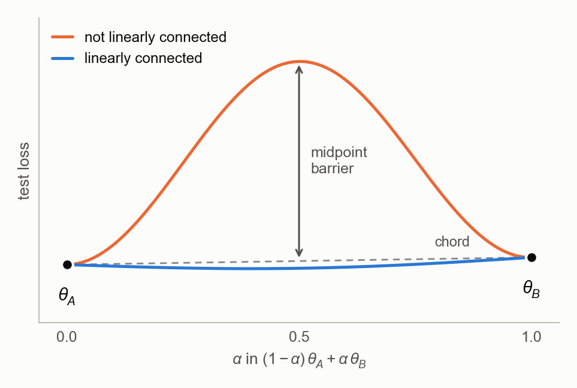
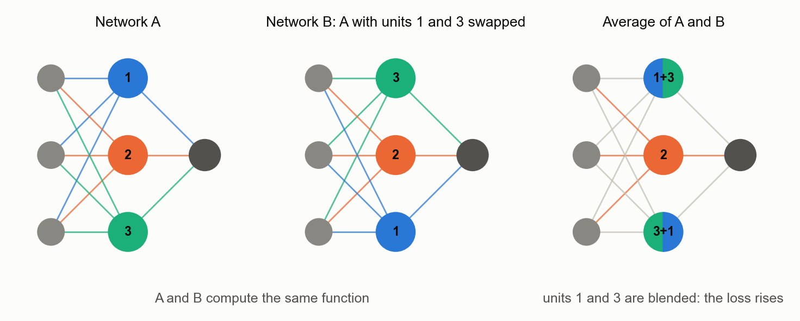
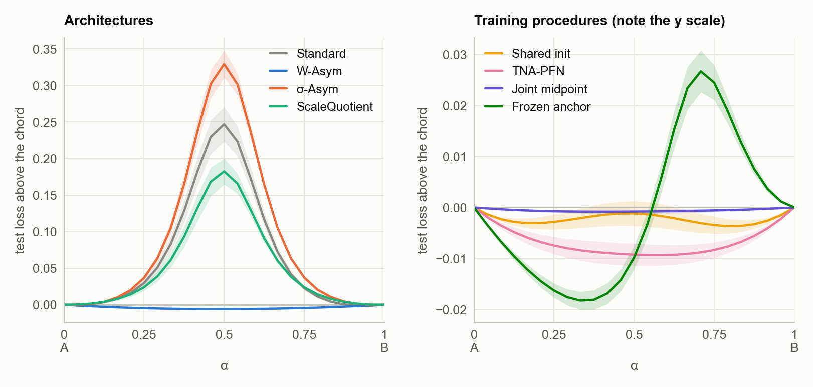
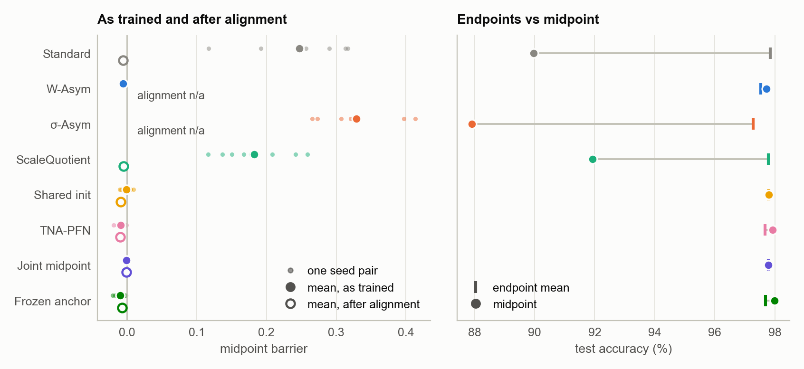
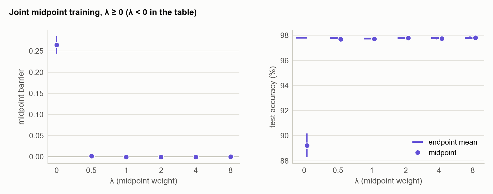

# Symmetry breaking and midpoint training: linear mode connectivity on MNIST

Two MLPs trained from different random initialisations usually cannot be averaged: the network whose weights are the mean of theirs performs much worse than either. One reason is permutation symmetry. Hidden units can be reordered without changing the function, so two independent runs end up with their units in unrelated orders.

This study compares seven ways of producing a pair of networks that can be averaged against a Standard baseline of two independently trained MLPs:

- architectures that break permutation symmetry (W-Asym and σ-Asym, Lim et al., 2024), and one meant to remove a rescaling symmetry (ScaleQuotient);
- a shared starting point (shared initialisation, and TNA-PFN, Li et al., 2024);
- training the midpoint directly (joint midpoint training and frozen anchor, designed for this project).

As Lim et al. report, W-Asym removes the barrier; here it costs 0.3 points of endpoint accuracy. σ-Asym raises the barrier, unlike in Lim et al., and ScaleQuotient does not change it detectably. On MNIST, starting both networks from the same initialisation already removes the barrier, and TNA-PFN's further reduction is not significant. Joint midpoint training and frozen anchor give a good midpoint because their loss includes it; joint midpoint training makes the two networks nearly the same function, and frozen anchor leaves a small barrier elsewhere on the path.

All numbers come from [`results/mnist/summary_main.md`](../results/mnist/summary_main.md), which `scripts/analyze_mnist.py` regenerates from the raw results.

## Background

<picture>
  <source media="(prefers-color-scheme: dark)" srcset="../figures/diagram_barrier_dark.png">
  
</picture>

For trained parameters θ_A and θ_B, the midpoint barrier is

    L(½(θ_A + θ_B)) − ½(L(θ_A) + L(θ_B)),

with L the test cross-entropy. The max barrier is the largest excess, over the whole segment, of L((1 − α)θ_A + αθ_B) above the chord (1 − α)L(θ_A) + αL(θ_B). Networks with a barrier near zero are called linearly mode connected (Frankle et al., 2020).

<picture>
  <source media="(prefers-color-scheme: dark)" srcset="../figures/diagram_permutation_dark.png">
  
</picture>

Permuting the hidden units of a network (rows of one weight matrix, together with the matching columns of the next) leaves its function unchanged. Two independently trained networks can differ by such a permutation, and averaging them then blends unrelated units. Permutation alignment (Ainsworth et al., 2023) reorders B's units to match A's before averaging. Entezari et al. (2022) conjecture that, once permutation invariance is taken into account, solutions found by SGD are likely to have no barrier between them.

## Methods

| method | architecture | how A and B are obtained |
|---|---|---|
| Standard | MLP: Linear → LayerNorm → GELU in each hidden layer | different initialisations, trained separately with different batch orders |
| W-Asym (Lim et al., 2024, Eq. 2) | in every linear layer, a fixed set of entries in each row is frozen at κ·N(0, 1), a different set for each row: 64, 64 and 128 entries per row with κ = 1, 0.5 and 0.25 (Lim et al.'s three-hidden-layer setting, adapted to this depth) | as Standard; A and B share the frozen values |
| σ-Asym (Lim et al., 2024, Eq. 4) | GELU replaced by FiGLU, sigmoid(Cx) ⊙ x, with a fixed C ~ N(0, 1) in each layer | as Standard; A and B share C |
| ScaleQuotient | each weight row divided by its norm and multiplied by a trainable gain: weight normalisation (Salimans & Kingma, 2016) | as Standard |
| Shared init (control) | MLP | B starts as an exact copy of A; trained separately with different batch orders |
| TNA-PFN (Li et al., 2024) | MLP | as shared init, and 40% of the entries of every weight matrix receive no gradient (the same entries in A and B) |
| Joint midpoint | MLP | different initialisations; trained together on the same batches with loss CE(A) + CE(B) + λ·CE(midpoint), λ = 2 |
| Frozen anchor | MLP | A trained normally, then frozen; B trained from its own initialisation with loss CE(B) + λ·CE(midpoint), λ = 2 |

"Midpoint" is the network with parameters ½(θ_A + θ_B). Its loss is computed with `torch.func.functional_call`, so its gradient reaches both networks (joint midpoint) or only B (frozen anchor).

W-Asym's mask and frozen values, σ-Asym's C and TNA-PFN's gradient mask are seeded by layer or parameter name only. They are therefore the same in every seed pair, and the variation between seed pairs comes from the initialisation and batch order alone. In TNA-PFN, AdamW's decoupled weight decay still shrinks the masked entries, by the same factor in A and B.

### Protocol `main`

Every number in this report uses it.

| setting | value |
|---|---|
| network | 784 → 256 → 256 → 10 (two hidden layers) |
| training | 6 epochs, batch 64, AdamW (lr 10⁻³, weight decay 0.03) |
| data | the 60,000 MNIST training images split at random (seed 42) into 54,000 for training and 6,000 held out (unused); evaluation on the 10,000 test images |
| replicates | 8 seed pairs per method. Pair *s* uses initialisation seeds 100*s* + 1 and 100*s* + 2 and batch-order seed 42 + *s*, so methods are compared paired by seed |
| compute | CPU (4 threads), roughly 13 to 55 s of training per pair |

The code also defines `lim_full` (three hidden layers of width 512, 25 epochs, Lim et al.'s MLP-MNIST size). It was not run.

### Measurements

- Test loss and accuracy at 25 evenly spaced points from A to B, giving the midpoint and max barriers. "Endpoint acc" is the mean of A's and B's test accuracy.
- Calibration: 15-bin expected calibration error (ECE; Guo et al., 2017) and Brier score, for both endpoints and the midpoint.
- The barrier after permutation alignment. Each hidden layer's units are matched by the cosine similarity of their incoming weights (Hungarian algorithm), once, first layer to last. Ainsworth et al.'s weight matching also uses the outgoing weights and iterates until no permutation changes. Alignment is computed only where a permutation is an exact symmetry: Standard, ScaleQuotient and the MLP-based procedures. W-Asym's frozen entries and σ-Asym's gates are tied to unit positions.
- Similarity of A and B: the cosine and Euclidean distance between their parameter vectors; the mean cosine between corresponding hidden-unit weight rows, before and after alignment; and linear CKA between their test-set logits (Kornblith et al., 2019). Parameter cosine, distance and row cosine leave out weight entries that receive no gradient (W-Asym's frozen positions, TNA-PFN's gradient-masked entries); alignment uses the full effective weights.

### Statistics

Values are mean ± SEM over the 8 seed pairs. Each method is compared with Standard by a paired t-test on the seed, with Benjamini–Hochberg (BH) q-values over the seven comparisons in each metric. The two further comparisons in the text (TNA-PFN against shared init, frozen anchor against joint midpoint) form one BH family of six tests. Midpoint against endpoint ECE is a paired t-test within each method, with BH over the eight methods, and joint midpoint training at λ = 0 is compared with Standard by a paired t-test on the seed.

## Results

<picture>
  <source media="(prefers-color-scheme: dark)" srcset="../figures/mnist_paths_dark.png">
  
</picture>

The paths are drawn as the loss above the chord, so each curve's peak approximates its max barrier (the table averages each pair's own peak). Bands are ± SEM over the 8 seed pairs.

<picture>
  <source media="(prefers-color-scheme: dark)" srcset="../figures/mnist_methods_dark.png">
  
</picture>

| method | endpoint acc (%) | midpoint acc (%) | midpoint barrier | max barrier | barrier after alignment |
|---|---:|---:|---:|---:|---:|
| Standard | 97.84 ± 0.05 | 89.97 ± 1.04 | 0.247 ± 0.024 | 0.248 ± 0.024 | −0.006 ± 0.001 |
| W-Asym | 97.54 ± 0.03 | 97.72 ± 0.03 | −0.006 ± 0.001 | 0.000 ± 0.000 | – |
| σ-Asym | 97.28 ± 0.05 | 87.92 ± 0.63 | 0.329 ± 0.019 | 0.329 ± 0.019 | – |
| ScaleQuotient | 97.78 ± 0.04 | 91.93 ± 0.67 | 0.182 ± 0.018 | 0.183 ± 0.018 | −0.005 ± 0.002 |
| Shared init | 97.80 ± 0.05 | 97.80 ± 0.08 | −0.001 ± 0.002 | 0.002 ± 0.001 | −0.009 ± 0.002 |
| TNA-PFN | 97.68 ± 0.07 | 97.92 ± 0.05 | −0.009 ± 0.002 | 0.000 ± 0.000 | −0.010 ± 0.002 |
| Joint midpoint | 97.78 ± 0.06 | 97.79 ± 0.06 | −0.001 ± 0.000 | 0.000 ± 0.000 | −0.001 ± 0.000 |
| Frozen anchor | 97.69 ± 0.07 | 98.00 ± 0.04 | −0.010 ± 0.002 | 0.027 ± 0.004 | −0.007 ± 0.003 |

### Architectures

Permutation symmetry accounts for the whole Standard barrier. Independently trained pairs have a midpoint barrier of 0.247; their midpoint is 7.9 points less accurate than the endpoints and its ECE is 4.3 points higher. Alignment moves 99.6% of the hidden units and brings the barrier to −0.006.

W-Asym removes the barrier without alignment (−0.006), as Lim et al. report for their larger MLP, with a midpoint slightly more accurate than the endpoints (97.72% against 97.54%) and as well calibrated (ECE 0.34% against 0.41%). The endpoints are 0.30 ± 0.04 points less accurate than Standard's (q < 0.001). Without any permutation, corresponding rows of A and B already have cosine 0.77 over their trainable entries, against 0.00 for Standard.

σ-Asym raises the barrier to 0.329 (+0.082 against Standard, q = 0.003) and costs 0.56 points of endpoint accuracy. Lim et al. report the opposite on their MNIST MLP: σ-Asym lowers the barrier from 0.188 to 0.117. The gate is drawn as in Lim et al.'s MNIST code (C ~ N(0, 1), unscaled), but their network is larger (three hidden layers of width 512) and trained for longer. Whether size or training length explains the opposite result was not tested.

ScaleQuotient's barrier, 0.182, is not detectably different from Standard's (q = 0.07). It was intended to remove a per-unit rescaling symmetry. With LayerNorm and GELU, rescaling one unit's weights changes the network's output, so there is no such symmetry to remove, and the layer is ordinary weight normalisation.

### Shared starting points

When B starts as a copy of A and only the batch order differs, the barrier is −0.001 with no accuracy cost. This agrees with Frankle et al. (2020), who found small MNIST networks stable to batch-order noise from initialisation. TNA-PFN adds a gradient mask to the shared start. Its barrier is lower than shared init's by 0.008 ± 0.003, which is not significant after correction (p = 0.029, q = 0.079), and its endpoints are 0.13 points less accurate (not significant). In this setting the mask's effect cannot be separated from the shared initialisation's.

### Training the midpoint

Both methods include the midpoint's loss in training, so a low midpoint barrier is expected rather than found. What differs is what happens to the two networks.

- Joint midpoint training gives a flat path (max barrier 0.000) at no accuracy cost. The two networks become nearly the same function: logit CKA 0.980, the highest of any method, against 0.916 for Standard. Alignment moves only 2% of their units.
- Frozen anchor gives the most accurate midpoint, 98.00%: 0.31 points above its endpoints and 0.21 above joint midpoint's, which is not significant (q = 0.079). B stays far from A (parameter distance 34.3 against 20.9 for joint midpoint; alignment would move 93.5% of units), and the path rises to a max barrier of 0.027 near α ≈ 0.7. Only α = 0.5 enters the loss, and with A frozen, B can meet that term without the rest of the path being low.

Joint midpoint training is close to learning a line of networks (Wortsman et al., 2021), which samples a random point on the segment at each step instead of fixing α = 0.5.

### Calibration

Where the barrier is near zero, the midpoint's ECE is within 0.1 points of the endpoints' (no method differs detectably). Its Brier score is often slightly lower than the endpoints': TNA-PFN 0.032 against 0.036, frozen anchor 0.031 against 0.036, W-Asym 0.034 against 0.037, consistent with the midpoint acting as a mild ensemble.

### Similarity of A and B

| method | parameter cosine | ‖θ_A − θ_B‖ | row cosine | row cosine, aligned | units moved (%) | logit CKA |
|---|---:|---:|---:|---:|---:|---:|
| Standard | 0.385 | 38.7 | 0.003 | 0.401 | 99.6 | 0.916 |
| W-Asym | 0.843 | 24.1 | 0.768 | – | – | 0.955 |
| σ-Asym | 0.361 | 39.0 | −0.001 | – | – | 0.887 |
| ScaleQuotient | 0.552 | 37.9 | 0.022 | 0.408 | 99.7 | 0.928 |
| Shared init | 0.757 | 24.3 | 0.605 | 0.613 | 10.4 | 0.922 |
| TNA-PFN | 0.842 | 17.9 | 0.665 | 0.666 | 0.4 | 0.926 |
| Joint midpoint | 0.821 | 20.9 | 0.660 | 0.660 | 2.3 | 0.980 |
| Frozen anchor | 0.518 | 34.3 | 0.142 | 0.342 | 93.5 | 0.890 |

Parameter cosine, distance and row cosine use trainable entries only; alignment, and so the share of units moved, uses the full effective weights. For TNA-PFN these include the 40% of entries that are identical in A and B, which can only favour the identity permutation, so its 0.4% of units moved is a lower bound. Every method with a low barrier also has A and B close in weight space without alignment (row cosine 0.6–0.8, against 0.00 for Standard), except frozen anchor (0.14). In function space the methods differ less: logit CKA is between 0.89 and 0.96 for all of them except joint midpoint training, at 0.98.

### Midpoint weight λ

<picture>
  <source media="(prefers-color-scheme: dark)" srcset="../figures/mnist_lambda_dark.png">
  
</picture>

Joint midpoint training with λ ∈ {−2, −1, −0.5, 0, 0.5, 1, 2, 4, 8}, 8 seed pairs each.

| λ | endpoint acc (%) | midpoint acc (%) | midpoint barrier | parameter cosine | ‖θ_A − θ_B‖ |
|---:|---:|---:|---:|---:|---:|
| −2 | 83.88 ± 1.58 | 0.34 ± 0.06 | 16,596 ± 108 | 0.969 | 61.2 |
| −1 | 90.77 ± 1.75 | 3.77 ± 1.65 | 15,871 ± 282 | 0.963 | 64.9 |
| −0.5 | 95.15 ± 0.78 | 7.16 ± 1.52 | 14,671 ± 239 | 0.944 | 74.3 |
| 0 | 97.81 ± 0.07 | 89.23 ± 0.94 | 0.264 ± 0.020 | 0.385 | 38.7 |
| 0.5 | 97.80 ± 0.08 | 97.70 ± 0.08 | 0.002 ± 0.001 | 0.615 | 30.8 |
| 1 | 97.74 ± 0.08 | 97.73 ± 0.09 | −0.000 ± 0.001 | 0.724 | 26.1 |
| 2 | 97.78 ± 0.06 | 97.79 ± 0.06 | −0.001 ± 0.000 | 0.821 | 20.9 |
| 4 | 97.76 ± 0.09 | 97.74 ± 0.09 | −0.000 ± 0.000 | 0.871 | 17.6 |
| 8 | 97.80 ± 0.10 | 97.82 ± 0.11 | −0.000 ± 0.000 | 0.889 | 16.3 |

- At λ = 0 the networks are trained side by side on the same batches with no coupling. Their barrier, 0.264, is not detectably different from Standard's 0.247 (paired on seed, p = 0.47).
- Every λ from 0.5 up removes the barrier without costing endpoint accuracy. Larger λ only pulls the two networks closer: parameter distance falls from 31 to 16 and parameter cosine rises from 0.62 to 0.89.
- With λ < 0 the loss rewards a high midpoint loss. The midpoint reaches 0.3–7% accuracy (chance is 10%) and test loss above 10⁴, and the endpoints degrade as well.

The λ = 2 row is the joint midpoint run of the main comparison: the same seeds give identical results.

### More than two networks

A midpoint clique trains K networks from different initialisations together, with a midpoint term for every pair (λ = 2); 4 cliques (seeds 0–3) were trained for each K. The midpoint terms are summed, not averaged, so the coupling grows with the number of pairs, K(K − 1)/2. Networks 0 and 1 of clique *s* have the same initialisations and batch order as joint midpoint pair *s*, so K = 2 reproduces seed pairs 0–3 of the main comparison. The "average" is the single network whose parameters are the mean of all K.

| K | pairs | endpoint acc (%) | average acc (%) | gain (points) | worst pair barrier |
|---:|---:|---:|---:|---:|---:|
| 2 | 1 | 97.72 ± 0.08 | 97.73 ± 0.10 | +0.02 ± 0.05 | −0.0011 ± 0.0006 |
| 3 | 3 | 97.78 ± 0.08 | 97.83 ± 0.07 | +0.05 ± 0.02 | −0.0012 ± 0.0004 |
| 4 | 6 | 97.66 ± 0.13 | 97.67 ± 0.12 | +0.01 ± 0.02 | −0.0002 ± 0.0007 |
| 5 | 10 | 97.72 ± 0.17 | 97.71 ± 0.16 | −0.01 ± 0.03 | +0.0003 ± 0.0002 |

Every pair stays connected up to K = 5. The average of all K networks, however, is no more accurate than its members: the gain is at most 0.05 points. The members are probably close to one function, as joint midpoint pairs are (logit CKA 0.98), so averaging them adds little. Each training step evaluates K networks and K(K − 1)/2 midpoints, so the cost grows roughly with K².

## Relation to prior work

W-Asym, the one method here that lowers the barrier without a shared start or a midpoint loss, reproduces Lim et al. (2024). Joint midpoint training, frozen anchor and midpoint cliques optimise the midpoint loss directly; line and subspace training (Wortsman et al., 2021) covers the same idea more generally. The shared-initialisation control removes the barrier on MNIST with no change to the architecture or loss, which leaves no room here for TNA-PFN to show an effect of its own.

The companion [fill study](fill_study.md) finds, in a one-hidden-layer setting, that W-Asym's barrier reduction comes from the two networks sharing non-zero frozen values rather than from breaking the symmetry as such.

## Limitations

- One dataset and small networks: MNIST, two hidden layers of width 256, 6 epochs. Lim et al.'s larger configuration, or harder datasets where a shared initialisation no longer suffices, may behave differently.
- The permutation alignment is a simplified, single-sweep matcher. It already removes the Standard barrier here, so a stronger matcher would not change the conclusions.
- λ = 2 and TNA-PFN's 40% mask ratio were not tuned; σ-Asym's gate scale follows Lim et al.'s MNIST code.
- W-Asym's mask and fill, σ-Asym's gates and TNA-PFN's mask are one draw each, shared by all seed pairs.

## References

- Ainsworth, Hayase, Srinivasa. Git Re-Basin: Merging Models modulo Permutation Symmetries. ICLR 2023.
- Entezari, Sedghi, Saukh, Neyshabur. The Role of Permutation Invariance in Linear Mode Connectivity of Neural Networks. ICLR 2022.
- Frankle, Dziugaite, Roy, Carbin. Linear Mode Connectivity and the Lottery Ticket Hypothesis. ICML 2020.
- Guo, Pleiss, Sun, Weinberger. On Calibration of Modern Neural Networks. ICML 2017.
- Kornblith, Norouzi, Lee, Hinton. Similarity of Neural Network Representations Revisited. ICML 2019.
- Li, Li, Lin, Shen, Lin, Wu. Training-time Neuron Alignment through Permutation Subspace for Improving Linear Mode Connectivity and Model Fusion. arXiv:2402.01342v1, 2024.
- Lim, Putterman, Walters, Maron, Jegelka. The Empirical Impact of Neural Parameter Symmetries, or Lack Thereof. NeurIPS 2024. Code: https://github.com/cptq/asymmetric-networks.
- Salimans, Kingma. Weight Normalization: A Simple Reparameterization to Accelerate Training of Deep Neural Networks. NeurIPS 2016.
- Wortsman, Horton, Guestrin, Farhadi, Rastegari. Learning Neural Network Subspaces. ICML 2021.
